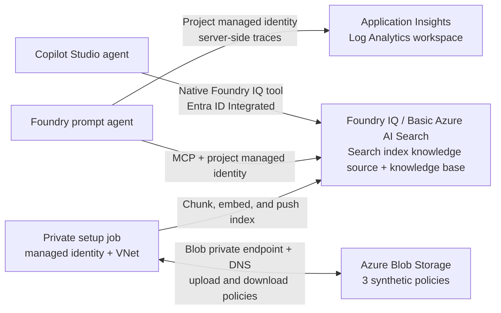

# Foundry IQ: one handbook, two agents

A small, synthetic employee-handbook demo. Azure Blob Storage supplies the
documents; Foundry IQ manages retrieval; a Foundry agent and a Copilot Studio
agent independently use the same knowledge base.



**No separate application API, API keys, SAS tokens, or storage credentials.**
Blob public access is disabled. A manual Container Apps job uploads and configures
the demo from a private VNet using managed identity; your terminal does not need
a VPN or private Blob connectivity. Search and Foundry retain Entra-authenticated
public endpoints for the Foundry and native Copilot Studio connections.
The handbook is shared demo content: this sample
does not configure per-document permissions or demonstrate employee-specific
authorization.

## What is created

All implementation files and local state stay inside `src/foundryiq`.

| Component | Purpose |
|---|---|
| Terraform in `infra/` | Resource group, private Blob Storage, Basic Search, Foundry account/project, models, RBAC |
| Private setup infrastructure | VNet, delegated runner subnet, separate endpoint subnet, Blob private endpoint/DNS, NAT egress, managed identity, manual Container Apps job |
| `data/*.md` | Fictional leave, expenses, and remote-work policies |
| `scripts/demo.py` | Private-job orchestration, Blob uploads/downloads, chunking/embedding/indexing, knowledge/agent setup, questions |
| `scripts/runner_bootstrap.py` | Authenticate the job with managed identity and execute the supplied demo bundle |
| Application Insights + Log Analytics | Keyless Foundry server-side agent/model/tool traces; 30-day retention, 1 GB/day caps |
| `scripts/telemetry.py` | Immediate response/MCP diagnostics and response-correlated trace queries |
| `Taskfile.yaml` | Provision/setup, destroy, ask, query traces, display endpoints, offline checks |
| [Copilot Studio walkthrough](docs/copilot-studio.md) | Connect the same knowledge base to a second agent |

The runner reads Markdown documents from the private Blob container, chunks and
embeds them, and pushes a hybrid text/vector index. A `searchIndex` knowledge
source connects that index to Foundry IQ. There is no managed Blob knowledge
source, indexer, Search-to-Blob shared private link, or S2 requirement.
The knowledge base uses low-effort model-backed planning and returns extractive
content; each agent composes its own cited answer.

## Prerequisites

- Azure CLI, Terraform 1.6+, Task v3, and Python 3.10+.
- Sign in with `az login` before running the tasks.
- A subscription where you can create resources **and role assignments**.
  Owner, or Contributor plus Role Based Access Control Administrator, is suitable.
  The Azure CLI identity must also be able to start/read the setup job.
  Your organization must allow the required resource providers to be registered.
- A `canadacentral` deployment supporting the selected models and agentic retrieval.
  The region, model versions, deployment SKUs, and capacities are configurable.
- Copilot Studio access and permission to create an agent and its connection in
  your Power Platform environment.
- Ruff for `task check` only; no Python runtime packages are required.
- `task up` checks for the Azure CLI `containerapp` extension and installs it if
  missing. The worker uses the pinned official Azure CLI image, not a local build.

This demo defaults to **Search Basic**. The private runner handles indexing, so
Search never needs to connect to private Blob Storage. Search, NAT Gateway, and
private endpoints add charges even when the setup job is idle. The job itself runs only
when started. This is a disposable single-region demo, not an HA architecture or
an all-services-private deployment. Job console logs are fetched after each execution;
the monitoring workspace stores Foundry traces, not job console logs or detailed
Search resource diagnostics. Monitoring adds ingestion/storage charges. The daily
ingestion caps are not a strict billing ceiling.

The defaults are `gpt-5.4-mini` version `2026-03-17` (`GlobalStandard`) and
`text-embedding-3-small` version `1` (`GlobalStandard`). `task up` checks the selected
subscription's regional model catalog and Search service quota before provisioning.
An existing same-tier Search service can be retried even when its tier quota is
fully used. Catalog presence and service quota do not guarantee live capacity or
model-deployment quota; deployment reports those errors explicitly.
GlobalStandard is a global deployment SKU, not a regional data-residency promise.

## Run

From `src/foundryiq`:

1. Copy `.env.example` to `.env`. Set `AZURE_SUBSCRIPTION_ID`; keep
   `AZURE_LOCATION=canadacentral` or choose another supported region. Set model
   overrides in the same file if needed.
   `TF_VAR_network_address_space` supplies the isolated VNet CIDR; the first two
   `/27` subnets are derived from it. Network addresses are not hardcoded in Terraform.
2. Run:

   ```bash
   task up
   ```

   Review Terraform's plan and enter `yes` to provision. The task starts the private job.
   The job verifies private Blob DNS before any upload, then uploads
   the policies, reads Markdown back from Blob, chunks and embeds the contents,
   and pushes the index. It checks every document-write result and waits until
   the current run's chunks are searchable with no obsolete chunks remaining.
   It then creates the index knowledge source, knowledge base, and managed-identity MCP connection,
   and creates the Foundry prompt agent. On later setup runs, it creates a new
   version of that agent. Initial provisioning and indexing can take several
   minutes. Terraform creates the Foundry
   project, chat deployment, and embedding deployment sequentially because those
   writes lock the same Foundry account.

   If upgrading an earlier copy, set these values in the existing `.env` before
   running `task up`:

   ```dotenv
   TF_VAR_search_sku=basic
   TF_VAR_network_address_space=10.88.0.0/16
   ```

   Do not destroy the partial deployment after an S2 quota failure: rerun `task up`
   to retain Basic and finish provisioning. Review the plan before accepting it.
   Do not use `task setup` alone until the runner's model role and new index
   configuration have been applied.

3. Ask the Foundry agent:

   ```bash
   task ask -- "How many days of annual leave do I get, and what can I carry over?"
   task ask -- "Can I work remotely four days a week, and claim a $450 monitor?"
   task ask -- "What is the parental leave entitlement?"
   ```

   After adding observability to an existing deployment, run `task up` once first.
   The answer is printed immediately, followed by response ID, elapsed time,
   returned token usage, and MCP call arguments/result previews. The command then
   waits up to `TRACE_WAIT_SECONDS=120` for matching App Insights telemetry.
   `TRACE_WAIT_SECONDS=0` performs one query (up to 30 seconds), without polling.
   Available traces show span/operation IDs, timings, status, and log messages;
   the full response, returned records, and exact KQL query are saved in ignored
   `.artifacts/traces/<response-id>.json`.

   If ingestion is delayed, the command explicitly reports **pending**.
   Retry without another model call:

   ```bash
   task traces -- <response-id>
   ```

   Correlation starts from the exact response ID and expands only its operation
   IDs over the last 24 hours; it never substitutes another request's traces.
   Finding some records does not mean every span has arrived. Output is capped at
   200 records; expand the saved KQL in App Insights for larger traces.
   A pending result does not fail a valid answer. API/auth/query errors do fail
   the task, after preserving the response artifact; retry `task traces`, not `ask`.
   Agent/tool failures remain failures even if telemetry arrives.

4. Run `task outputs`, then follow [Connect Copilot Studio](docs/copilot-studio.md).
   Ask the same questions in Copilot Studio to demonstrate reuse.

No commands in this sample are run against Azure automatically by a coding
assistant; the tasks are for you to execute.

## Destroy or change region

```bash
task down
```

This follows the document-intelligence Taskfile's fast cleanup pattern:
`az group delete --yes --no-wait`, followed by local Terraform state and cache
cleanup. The resource group is read from state, including after a partial apply.
Azure continues deleting the group in the background. Agents, knowledge bases,
and uploaded data are removed with their parent services.
Deleting the Container Apps environment also removes its provider-managed
infrastructure resource group; the task does not directly delete managed groups.

Cleanup stops if Terraform has an active state lock, the selected subscription
does not match state, or Azure rejects the deletion request. Local state is
removed only after Azure accepts the request. The committed provider lock file
is retained.

To move an existing deployment to Canada Central, run `task down` **before**
`task up`. Set these values in `.env` for the new deployment:

```dotenv
AZURE_LOCATION=canadacentral
TF_VAR_embedding_model_sku=GlobalStandard
```

Then run `task up`. The region guard blocks provisioning over a state that still
contains the old region's resource group. Keep the same subscription selected
while deleting the old deployment. Canada Central advertises GlobalStandard,
not regional Standard, for this embedding model. Search service capacity can
still change between checking regional support and provisioning.

## Demo talk track

| Question | Expected grounded facts |
|---|---|
| Annual leave and carryover? | 20 working days; carry over up to 5; use carryover by March 31 |
| Four remote days and a $450 monitor? | More than 3 remote days requires manager + HR approval; equipment allowance is $400/year with manager pre-approval; the policy does not promise reimbursement above the limit |
| $210 hotel and $80 dinner? | Hotel limit $180/night before tax, with director pre-approval above the limit; meals $65/day on approved overnight travel |
| Parental leave entitlement? | Not defined in the handbook; the agent should say it does not know |

Point out document citations in each answer. In Foundry, open the generated
project in [the Foundry portal](https://ai.azure.com), select
`employee-handbook-agent`, and inspect its MCP tool and conversation trace.
`task ask` fails if the response does not complete, returns a tool error, or
contains no MCP call. It does not evaluate answer correctness or prove citation
accuracy; check the cited policy against the table above.

For a refresh demo, edit an existing policy in `data/`, run `task setup`, and ask
both agents about the new value in fresh conversations. `setup` checks the current
indexing run, rather than accepting an older success. It overwrites matching blobs,
then indexes **all Markdown blobs** in the handbook container, including blobs
whose local files were removed. It does not delete blobs. It reconciles obsolete
index chunks after successful uploads, for example when a policy becomes shorter.
Indexing runs only through `task up` or `task setup`, not on a background schedule.

## Authentication and permissions

| Identity | Scope | Role |
|---|---|---|
| Search system identity | Foundry account hosting the models | Cognitive Services OpenAI User |
| Foundry project system identity | Search service | Search Index Data Reader |
| Foundry project system identity | Application Insights | Monitoring Metrics Publisher |
| Azure CLI demo operator | Handbook container | Storage Blob Data Contributor |
| Azure CLI demo operator | Search service | Search Service Contributor + Search Index Data Contributor |
| Azure CLI demo operator | Foundry account | Foundry User + Foundry Project Manager |
| Azure CLI demo operator | Application Insights and its Log Analytics workspace | Log Analytics Reader |
| Setup job managed identity | Handbook container | Storage Blob Data Contributor |
| Setup job managed identity | Search service | Search Service Contributor + Search Index Data Contributor |
| Setup job managed identity | Foundry account | Foundry User + Foundry Project Manager + Cognitive Services OpenAI User |

`task up` derives the operator object ID from the selected Azure CLI token.
Terraform's deployment service principal can be different; its identity is not
silently reused for operator permissions. The private job signs in with its own
user-assigned managed identity. Only the sample scripts, synthetic policy files,
and non-secret configuration are sent to the job: never `.env`, Terraform state,
Azure CLI caches, or access tokens.

The connection uses `ProjectManagedIdentity` with the Search audience.
The project also has an `AppInsights` connection authenticated with its managed
identity. Monitoring resources disable local authentication. Only resource IDs
and the non-secret application ID are output; no instrumentation key or
connection string is output, bundled, or supplied by the sample.
The runner uses its managed identity for Blob downloads and embedding requests.
Search uses its system identity to vectorize queries with the same embedding model.
Terraform state is local and can contain provider-managed sensitive attributes;
it and `.env` are ignored. Do not share state files. Naming matches the existing
Foundry infrastructure: `${random_pet.this.id}-${random_id.this.dec}` is the base,
with `-foundry`, `-project`, and `-ai_rg` suffixes. Search uses
`${project_name}-search`; Storage uses 22 UUID hex characters followed by `sa`.

## Troubleshooting

| Symptom | Action |
|---|---|
| Model/SKU not advertised | Change model name/version/SKU or region in `.env` **before the first deployment**, then rerun `task up` |
| Search service quota exhausted | Preflight reports tier, usage, and limit before Terraform. Keep `TF_VAR_search_sku=basic` for this path, or request quota for your chosen tier |
| Insufficient model quota or unavailable capacity | Adjust model deployment capacities or request quota; rerun `task up` |
| Search reports regional capacity exhaustion | Choose another supported region; use `task down` first if moving an existing deployment |
| Blob `403 AuthorizationFailure` | A network block, not a generic RBAC wait: check the runner's private endpoint/DNS. The script fails immediately and shows the request URL and server error |
| Other setup 401/403 | Confirm the correct runtime identity and roles above; propagation retries are bounded and show method, endpoint, and error detail |
| Traces pending | Ingestion and role/connection propagation can take several minutes; use the printed response ID with `task traces` |
| Telemetry query 401/403 or query error | Confirm the CLI operator's Log Analytics Reader access and the project identity's Monitoring Metrics Publisher role; inspect the saved error and retry `task traces` after propagation |
| Private Blob DNS check fails | Check the private DNS zone, VNet link, and Blob endpoint; the worker rejects public or mixed DNS answers |
| Private setup job fails | `task setup` prints that execution's console logs and returns failure; correct the reported cause and rerun it |
| Setup execution already active | Wait for that execution; the script refuses to start another known-active setup |
| Indexing batch fails | Setup reports failed or missing document results; check the runner's Search data role and model configuration, then run `task setup` |
| Index visibility times out | Setup stops after five minutes if current-run or total chunk counts differ; inspect the job logs and demo index before retrying |
| Agent tool call fails | Check the project's Search reader role, managed-identity connection, and MCP endpoint from `task outputs` |
| Blob citation link prompts for access or returns 403 | Documents are private; a citation is not a public download link. Review the matching local policy or open the blob using an authorized identity |
| Region/subscription mismatch with state | Restore the original subscription; `task down` accepts a changed region while targeting the group recorded in state |
| Cleanup reports a Terraform state lock | Finish or stop the running Terraform operation before running `task down` |

Changing the subscription or region in an existing state can replace resources.
Use one copy/state per deployment. Cleanup is explicit through `task down`;
neither `task up` nor the setup script tears down infrastructure.

## Offline checks

```bash
task check
```

This runs Terraform formatting and schema validation, Ruff, standard-library unit
tests with mocked service calls, and an offline Terraform dependency-graph check. Initialize
providers first with `terraform -chdir=infra init -backend=false` if you have
not run `task up` yet. `task up` also runs `terraform validate` after provider
initialization. Offline checks cannot verify live Azure provisioning, MCP
execution, model capacity, or Copilot Studio integration.

## Microsoft references

- [Foundry IQ overview](https://learn.microsoft.com/azure/foundry/agents/concepts/what-is-foundry-iq)
- [Search index knowledge source](https://learn.microsoft.com/azure/search/agentic-knowledge-source-how-to-search-index)
- [Index requirements for agentic retrieval](https://learn.microsoft.com/azure/search/agentic-retrieval-how-to-create-index)
- [Generate embeddings](https://learn.microsoft.com/azure/foundry/openai/how-to/embeddings)
- [Create a knowledge base](https://learn.microsoft.com/azure/search/agentic-retrieval-how-to-create-knowledge-base)
- [Connect a knowledge base to Foundry Agent Service](https://learn.microsoft.com/azure/foundry/agents/how-to/foundry-iq-connect)
- [Connect Foundry IQ in Copilot Studio](https://learn.microsoft.com/microsoft-copilot-studio/agents-experience/foundry-iq-connect)

The sample uses Search REST `2026-11-01-preview` for knowledge source/base and MCP
operations, ARM `2025-10-01-preview` for the remote-tool connection, and Foundry
agent API `v1`. The MCP and remote-tool connection integration includes preview
capabilities. Recheck the linked documentation if those contracts change.
