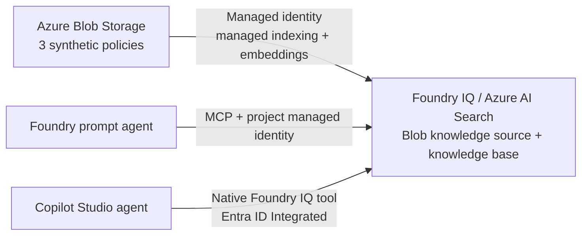

# Foundry IQ: one handbook, two agents

A small, synthetic employee-handbook demo. Azure Blob Storage supplies the
documents; Foundry IQ manages retrieval; a Foundry agent and a Copilot Studio
agent independently use the same knowledge base.



**No separate app, containers, API keys, SAS tokens, or storage credentials.**
Public endpoints are enabled, but anonymous Blob access and local-key
authentication are disabled. The handbook is shared demo content: this sample
does not configure per-document permissions or demonstrate employee-specific
authorization.

## What is created

All implementation files and local state stay inside `src/foundryiq`.

| Component | Purpose |
|---|---|
| Terraform in `infra/` | Resource group, Blob Storage, Search, Foundry account/project, model deployments, RBAC |
| `data/*.md` | Fictional leave, expenses, and remote-work policies |
| `scripts/demo.py` | Upload, knowledge source/base setup, managed-identity connection, agent creation, questions |
| `Taskfile.yaml` | Provision/setup, ask, display endpoints, offline checks |
| [Copilot Studio walkthrough](docs/copilot-studio.md) | Connect the same knowledge base to a second agent |

Search creates and manages the data source, index, indexer, and embedding pipeline
for the Blob knowledge source. Do not separately maintain those generated objects.
The knowledge base uses low-effort model-backed planning and returns extractive
content; each agent composes its own cited answer.

## Prerequisites

- Azure CLI, Terraform 1.6+, Task v3, and Python 3.10+.
- Sign in with `az login` before running the tasks.
- A subscription where you can create resources **and role assignments**.
  Owner, or Contributor plus Role Based Access Control Administrator, is suitable.
  Your organization must allow the required resource providers to be registered.
- An `eastus2` deployment supporting the selected models and agentic retrieval.
  The region, model versions, deployment SKUs, and capacities are configurable.
- Copilot Studio access and permission to create an agent and its connection in
  your Power Platform environment.
- Ruff for `task check` only; no Python runtime packages are required.

The defaults are `gpt-5-mini` version `2025-08-07` (`GlobalStandard`) and
`text-embedding-3-small` version `1` (`Standard`). `task up` checks the selected
subscription's regional model catalog before provisioning. Catalog presence is
not a quota or capacity guarantee; deployment reports those errors explicitly.
GlobalStandard is a global deployment SKU, not a regional data-residency promise.

## Run

From `src/foundryiq`:

1. Copy `.env.example` to `.env`. Set `AZURE_SUBSCRIPTION_ID`; keep
   `AZURE_LOCATION=eastus2` or choose another supported region. Set model
   overrides in the same file if needed.
2. Run:

   ```bash
   task up
   ```

   Review Terraform's plan and enter `yes` to provision. The task then uploads
   the policies, creates the Blob knowledge source, waits for successful
   ingestion, creates the knowledge base and managed-identity MCP connection,
   and creates the Foundry prompt agent. On later setup runs, it creates a new
   version of that agent. Initial provisioning and indexing can take several
   minutes. Indexing polls every five minutes.

3. Ask the Foundry agent:

   ```bash
   task ask -- "How many days of annual leave do I get, and what can I carry over?"
   task ask -- "Can I work remotely four days a week, and claim a $450 monitor?"
   task ask -- "What is the parental leave entitlement?"
   ```

4. Run `task outputs`, then follow [Connect Copilot Studio](docs/copilot-studio.md).
   Ask the same questions in Copilot Studio to demonstrate reuse.

No commands in this sample are run against Azure automatically by a coding
assistant; the tasks are for you to execute.

## Demo talk track

| Question | Expected grounded facts |
|---|---|
| Annual leave and carryover? | 20 working days; carry over up to 5; use carryover by March 31 |
| Four remote days and a $450 monitor? | More than 3 remote days requires manager + HR approval; equipment allowance is $400/year with manager pre-approval; the policy does not promise reimbursement above the limit |
| $210 hotel and $80 dinner? | Hotel limit $180/night before tax, with director pre-approval above the limit; meals $65/day on approved overnight travel |
| Parental leave entitlement? | Not defined in the handbook; the agent should say it does not know |

Point out document citations in each answer. In Foundry, open the generated
project in [the Foundry portal](https://ai.azure.com), select
`employee-handbook-agent`, and inspect its MCP tool and conversation trace.
`task ask` fails if the response does not complete, returns a tool error, or
contains no MCP call. It does not evaluate answer correctness or prove citation
accuracy; check the cited policy against the table above.

For a refresh demo, edit an existing policy in `data/`, run `task setup`, and ask
both agents about the new value in fresh conversations. `setup` waits for an
ingestion run started after the uploads, rather than accepting an older success.
It overwrites matching blobs but does **not** delete blobs if a local file is
removed. This sample intentionally provides no deletion task.

## Authentication and permissions

| Identity | Scope | Role |
|---|---|---|
| Search system identity | Handbook container | Storage Blob Data Reader |
| Search system identity | Foundry account hosting the models | Cognitive Services OpenAI User |
| Foundry project system identity | Search service | Search Index Data Reader |
| Terraform caller / demo operator | Handbook container | Storage Blob Data Contributor |
| Terraform caller / demo operator | Search service | Search Service Contributor + Search Index Data Reader |
| Terraform caller / demo operator | Foundry account | Foundry User + Foundry Project Manager |

The connection uses `ProjectManagedIdentity` with the Search audience.
The Blob knowledge source's API field is named `connectionString`, but its value
is only `ResourceId=<storage ARM ID>`: no credential is used or output.
Terraform state is local and can contain provider-managed sensitive attributes;
it and `.env` are ignored. Do not share state files. Resource names derive from
`random_pet` + `random_id`, not caller-supplied names.

## Troubleshooting

| Symptom | Action |
|---|---|
| Model/SKU not advertised | Change model name/version/SKU or region in `.env` **before the first deployment**, then rerun `task up` |
| Insufficient quota or unavailable capacity | Adjust deployment capacities or request quota; rerun `task up` |
| Setup receives 401/403 | Confirm the identity and roles above; setup retries authorization propagation for up to five minutes per request |
| Indexing fails or processes no documents | Inspect the Blob knowledge source status in Search and its generated indexer's errors; fix the reported Blob/model permission or model configuration, then run `task setup` |
| Ingestion takes too long | Setup stops after 20 minutes with the last status; inspect the indexer before retrying |
| Agent tool call fails | Check the project's Search reader role, managed-identity connection, and MCP endpoint from `task outputs` |
| Blob citation link prompts for access or returns 403 | Documents are private; a citation is not a public download link. Review the matching local policy or open the blob using an authorized identity |
| Region/subscription mismatch with state | Restore the original `.env`; use a separate copy of the demo for a different deployment |

Changing the subscription or region in an existing state can replace resources.
Use one copy/state per deployment. This demo does not include automatic cleanup
or execute any resource deletion.

## Offline checks

```bash
task check
```

This runs Terraform formatting, Ruff, and standard-library unit tests with mocked
service calls. `task up` also runs `terraform validate` after provider
initialization. Offline checks cannot verify live Azure provisioning, MCP
execution, model capacity, or Copilot Studio integration.

## Microsoft references

- [Foundry IQ overview](https://learn.microsoft.com/azure/foundry/agents/concepts/what-is-foundry-iq)
- [Blob knowledge source](https://learn.microsoft.com/azure/search/agentic-knowledge-source-how-to-blob)
- [Create a knowledge base](https://learn.microsoft.com/azure/search/agentic-retrieval-how-to-create-knowledge-base)
- [Connect a knowledge base to Foundry Agent Service](https://learn.microsoft.com/azure/foundry/agents/how-to/foundry-iq-connect)
- [Connect Foundry IQ in Copilot Studio](https://learn.microsoft.com/microsoft-copilot-studio/agents-experience/foundry-iq-connect)

The sample uses Search REST `2026-11-01-preview` for knowledge source/base and MCP
operations, ARM `2025-10-01-preview` for the remote-tool connection, and Foundry
agent API `v1`. The MCP and remote-tool connection integration includes preview
capabilities. Recheck the linked documentation if those contracts change.
